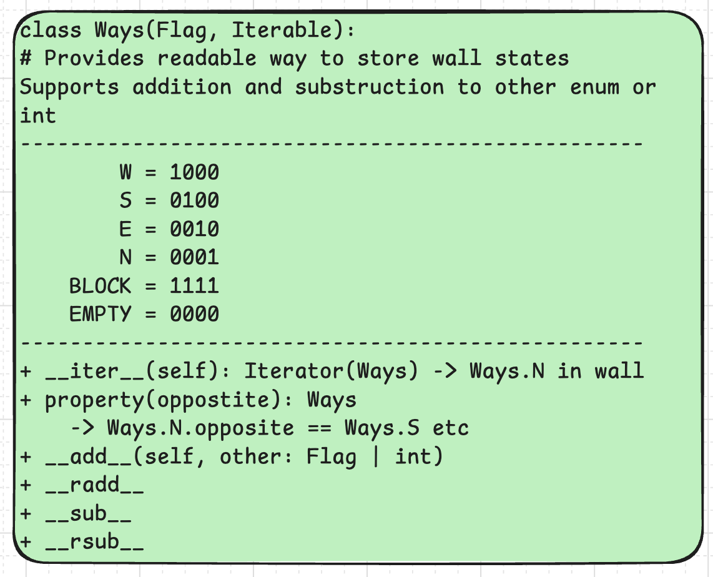

*This project has been created as part of the 42 curriculum by mabarlag, eepyemy*

## Description

For this Codam duo project named A-Maze-ing the goal is to create a maze generator in Python that takes a configuration file and generates a maze in a hexadecimal file. The configuration file states if the maze has to be a perfect maze (with a single path between entrance and exit), or a pacman-like maze with multiple loops. Parsing the generated hexadecimal file, the generator displays a human-readable maze in the terminal. The learning objectives are to design and implement a maze algorithm, including solving the maze and writing the result to the terminal in a structured way. It is asked to organize the code so that the generation logic can be reused later. This way creating a package for distribution is learned, from structuring the source files and writing the build configuration to choosing a license that allows the generator to be reused and redistributed.

### __Result__  

The program reads a configuration file and stores the configuration of the maze to be generated. Regardless of whether the configuration specifies a perfect or a pacman-like maze, a perfect maze is always generated first, by breaking walls using the depth-first search algorithm. By keeping track of the direction in each `Room`, the solution is stored while the maze is being generated. If `PERFECT` is `False` and a pacman-like maze has to be generated, `_remove_deadends` is called after the perfect maze has been created. Since removing dead ends can create loops, and with them shorter routes, the shortest path is then recalculated using breadth-first search (BFS). The randomness with which walls are broken is based on the seed. Once the maze has been generated and validated, it is converted into a hexadecimal output file. With this file, the maze can be printed in a human-readable format in the terminal. Each unique maze can be reproduced using its seed. The program includes a menu in which the user can choose the following actions: regenerating the maze, showing or hiding the shortest path, changing the wall colour, and entering a custom seed.
<br>

### __Overview__

__The code structure overview:__  
| File | Description |
|------|-------------|
| `a_maze_ing.py` | The main program: puts everything together and handles errors. |
| `config.txt` & `42.txt` | Input: the maze settings and the shape of the "42" pattern. |
| `config.py` | Reads `config.txt` and turns it into a dictionary of strings. |
| `abstract.py` | General building blocks: `Vector` (coordinate), `Cell` (square) and `Grid`. |
| `enums.py` | Directions: `Step` (movement as a vector) and `Ways` (walls as bits). |
| `data.py` | Maze-specific classes: `Room` and `Maze`. |
| `safe_types.py` | Custom pydantic types that validate the values from the config. |
| `generator.py` | The algorithm: `MazeGenerator` builds the maze, finds the shortest path and writes the output file. |
| `display.py` | `MazePrinter` reads the output file and prints the maze in colour in the terminal. |
| `menu.py` | The interactive menu (`Menu`, `Action`, `choose_action`). |
<br>

__The data structure overview:__  
*Navigation*  
Two ways are used to describe a direction: `Step` and `Ways`. A `Step` describes the movement as a `Vector` (coordinates). For example, `STEP.RIGHT` is equal to the movement (1, 0). A step to the right is an increase of 1 on the x-axis, while the y-axis stays the same. `Ways` uses the walls as bits (WSEN). `Ways.E` is the right wall of a cell, which is `0b0010` in bits.


<br>

*Coordinates*  
The origin (0, 0) is the top-left cell. `x` is the column (it increases to the right) and `y` is the row (it increases downwards). This is why `Step.UP` is (0, -1). A cell is always accessed with `maze[x, y]`. Looping over a maze (`for room in maze`) goes row by row, from left to right, which is also the order of the output file.
<br>

*General building blocks (`abstract.py`)*  
| Class | Description |
|-------|-------------|
| `Vector` | An immutable (frozen) 2D coordinate `(x, y)`. Supports `+`, `-`, `*`, `==` and unpacking: `x, y = vector`. |
| `Cell` | One square of a grid. It knows its own position and the grid it belongs to. `cell + Step.RIGHT` returns the neighbouring cell, or `None` at the border. |
| `Grid` | A 2D grid of cells, internally stored as a list of columns (`_grid[x][y]`). Can also be loaded from a file, which is how `42.txt` is read. |
<br>

*Maze-specific classes (`data.py`)*  
A `Room` is a `Cell` with four attributes. Their class-level defaults describe a fresh, closed room:

| Attribute | Type | Default | Meaning |
|-----------|------|---------|---------|
| `visited` | `bool` | `False` | Visited during generation (DFS) or path finding (BFS). |
| `blocked` | `bool` | `False` | Part of the "42" pattern; its walls can never be removed. |
| `walls` | `Ways` | `Ways.ALL` | The walls that are currently closed. |
| `path_hint` | `Ways` | `Ways.NONE` | The direction to take from this room to get closer to the exit. |

`Room.map` is a dictionary `{neighbour: direction}` with the existing neighbours of a room (2 in a corner, 3 on a border, 4 elsewhere). The order of the neighbours is shuffled once per room; this is where the randomness of the maze comes from. `Room.connect_with(neighbour)` breaks the wall between two rooms on *both* sides (for example east of one room and west of the other), so neighbouring rooms always agree on their shared wall.

A `Maze` is a `Grid` of `Room`s with an `entry` and an `exit`. A new maze starts with all walls closed. `Maze.valid` checks that every room's walls match its neighbours and that the outer border is closed.
<br>

*Configuration (`config.py`)*  
`ConfigParser` reads `config.txt` into a dictionary of strings, for example `{"width": "20", "perfect": "False"}`. `MazeConfig` (a pydantic model) validates these values and converts them to the right types: `"20"` becomes `20`, `"0,0"` becomes `Vector(0, 0)` and `"False"` becomes `False`.
<br>

*Generator state (`generator.py`)*  
`MazeGenerator` keeps the last generated maze (`last_maze`) and the shortest path (`path`, a list of `Ways` such as `[Ways.E, Ways.S, ...]`). To check the non-perfect (Pac-Man) mode it also counts the openings (`_edges`) and the open rooms (`_rooms`). The number of independent loops is `openings - rooms + 1`, which must be at least 2.
<br>

*Output file*  
Each room is written as one hexadecimal digit (its `walls` value), one line per row. After an empty line follow the entry, the exit and the shortest path as letters:
```
9551553
...
0,0
19,9
SSESEENW...
```
<br>

__The structure and format of your config file:__  
The config file is a plain text file with one setting per line, in the format `KEY=VALUE`. Empty lines are skipped, and everything after a `#` is treated as a comment. Spaces around the key and value are removed, and keys are not case-sensitive.

Example (`config.txt`):

    WIDTH=20
    HEIGHT=10
    ENTRY=0,0
    EXIT=19,9
    OUTPUT_FILE=maze.txt
    PERFECT=False
    SEED=42

| Key | Format | Description |
|-----|--------|-------------|
| `WIDTH` | Positive integer | Number of columns in the maze. |
| `HEIGHT` | Positive integer | Number of rows in the maze. |
| `ENTRY` | `x,y` | Coordinates of the entry. |
| `EXIT` | `x,y` | Coordinates of the exit. |
| `OUTPUT_FILE` | File name | Path of the hexadecimal output file. |
| `PERFECT` | `True` or `False` | `True` creates a perfect maze, `False` creates a pacman-like maze with loops. |
| `SEED` | Positive integer (optional) | Makes the maze reproducible. If left out, a random seed is chosen. |
<br>

All values are validated with pydantic (see `safe_types.py`). The "42" pattern is only added if the maze is at least 9 × 6. Otherwise it is skipped.

__The maze generation algorithm overview:__  
*Depth-First Search (DFS)*  
The maze is generated using DFS, on a grid in which every room starts with all 4 walls. The search starts at the exit. The neighbours of each room are stored in a random order, based on the seed. The program keeps a list of possible moves, as pairs of (from room, to room). The newest move is always taken first. When a move leads to a room that has not been visited yet, the wall between the two rooms is broken and the neighbours of the new room are added to the list. Rooms that are already visited, or that are part of the "42" pattern, are skipped. Because the newest move is taken first, the path keeps going as deep as possible. When it gets stuck, it automatically goes back to the last room that still has an unvisited neighbour. This continues until all rooms have been visited. Every room stores the opposite direction of the broken wall in `path_hint`. This direction points back towards the exit, so the solution path in the perfect maze is known as soon as the maze is finished.

*Breadth-First Search (BFS)*  
BFS is only used when `PERFECT` is `False`. After the perfect maze has been made, `_remove_deadends` breaks extra walls to create loops. Because of these loops, the path found by DFS may no longer be the shortest one. BFS also starts at the exit, but it does not break any walls: it only moves through openings that already exist. BFS always takes the oldest move first, so it visits the rooms in order of distance: first all rooms 1 step from the exit, then all rooms 2 steps away, and so on. The first time a room is reached is therefore always via the shortest route, and that direction is stored in `path_hint`. The new `path_hint` values are also used to check that every room in the maze can be reached.

*One function for both*  
DFS and BFS use the same function, `_walk`. The only difference is which move is taken from the list: DFS takes the newest move (like a stack), BFS takes the oldest move (like a queue). What happens in each room is decided by the function that is passed to `_walk`: `_connect` breaks walls during DFS, and `_find_path` only follows open paths during BFS.

__Why this algorithm:__  
*DFS*  
DFS was chosen for three reasons. First, it always creates a perfect maze: every room can be reached, and there is exactly one path between any two rooms (a spanning tree). Second, DFS keeps going in one direction for as long as it can, so it creates long, winding corridors with few side branches. This makes the maze harder to solve. Third, because the DFS starts at the exit, every room remembers the direction it came from. This means the solution path is found at the same time as the maze is generated, without extra work.

*BFS*  
BFS was chosen because it always finds the shortest path in a maze where every step has the same length, even when the maze has loops. It also needed very little extra code, because it reuses the same `_walk` function as DFS. Only the order in which moves are taken is different.

## Instructions
__Reusable code, the package:__  
The package is situated in the dist folder: mazegen-1.0.0-py3-none-any.whl. Install the package with:
```bash
pip install [path]/mazegen-1.0.0-py3-none-any.whl
```
After installing import the MazeGenerator class from mazegen:
```
from mazegen import MazeGenerator
```

With the MazeGenerator class it's possible to initialize instances of the class. As parameters Python values can be used Mazegenerator(width=25, ...) but it's also possible to use text from a config file.

__Running the project:__  
To run the A-Maze-ing project, you first have to install the requirements. After, you can run the program with make. Under the hood, the config file is added as a parameter in the Makefile:

```
run:
	$(MAKE) ready
	echo $(PY_VER)
	uv run --python $(PY_VER) a_maze_ing.py config.txt
```

Running project: 
```bash
 cd PROJECT_NAME
 make install
 make run
```

As stated in the subject, we were not allowed to provide the tests in our main branch. You can still get the tests by visiting another branch. First, switch to the tester branch. Second, run pytest:
```bash
git checkout tester
pytest
```

## Team & Project Management
 
__Roles and responsibilities:__  
Since Emy is more experienced with Python, we decided to kick off the project using pair programming sessions. In pair programming, you alternate between the roles of "driver" and "navigator." The driver is in charge of the keyboard and writing the code, while the navigator keeps an eye on the broader strategic picture and reviews the code as it is being typed. Through pair programming, we were able to develop the Makefile and set up a virtual environment.

We continued pair programming working on parsing the config file. We then had to conclude that if we used pair programming for each part we would not meet the deadline. We took three days to develop the plan in Excalidraw so that we could distribute the parts. This is the distribution we started with:

data.py - Emy
config.py - Emy
menu.py - Maud
display.py - Maud

When working on data.py, Emy also created abstract.py. This file holds the base classes maze classes can be based on, like abstract classes. By keeping the general building blocks separate from the maze-specific classes, they can be reused for any other grid-based structure, as is already done for loading the "42" pattern from `42.txt` as a `Grid`. Emy worked this out completely and then explained it to Maud.

We used the pair programming strategy again when we started working on generator.py. After, Emy took the lead here and explained what she did. Emy wrote the DFS algorithm for generating the perfect maze and Maud researched BFS for finding the path in the pacman-like maze. Emy worked on safe_types.py and Maud worked on creating the package and the documentation.

__Anticipated planning:__  
Beginning the project, we were ambitiously aiming to finish the project within 3 weeks. Unfortunately, after five days, first Maud became ill and then Emy, which caused us to fall far behind. We kept a logbook during these first days:

><br>
>	[Day 1]: Figured out the process of using git in team projects,  
>	agreed to use branches for each feature we are working on,  
>	pushing to main once the code is stable enough.  
>   <br>Practiced merge conflict resolution
>
><br>

<br>

><br>
>	[Day 2]: Tried out pair programming and choose it as  
>   development strategy. Also delved into installing a virtual environment.  
>   Chose to use Conda because it allows to select the version of Python.  
>   Managed to set up the environment using our Makefile.  
>   
><br>

<br> 

><br>
>	[Day 3]: Were stuck with troubleshooting conda for a while.
>   Ended up with a working solution, but too loaded with
>   implicit rules on how it is supposed to work, which
>   makes it hard to understand.   
>   
><br>

<br>

><br>
>	[Day 4]: Changed the package manager from Conda to uv. Got it to work on both Linux and Mac. Decided to print python version when running program (still has to be implemeted). Started on writing python code to parse the config file.
>   
><br>

<br> 

><br>
>	[Day 5]: Oohno.. We got sick and it took us three weeks to get back working on the code..
>   
><br>

<br> 

__How the planning evolved:__  
After the weeks of illness, we had to take things slowly at first. On 30 September we started working on the project at Codam again, full of good spirits. Our plan was to build the project in small steps, starting with the data structure and working up to the more complex features: first the wall encoding and the output file, then the display, the config parsing, the DFS generator, the BFS solver, and finally the "42" pattern, the pacman-like mode and the interactive menu.

In practice, some parts took much longer than expected. Getting the abstract classes in `abstract.py` to do what they needed to do took a lot of time, mostly because of struggles with mypy and type hinting. Along the way, the research we did also changed. At the start it was about the basics: how to store walls as bits, how DFS carves a maze, and why BFS should start at the exit to find the shortest path. Later it was mainly about making the code solid: handling Pydantic validation errors, fixing visual bugs in the display, writing proper docstrings, and passing `make lint`. At the end, the focus moved to the reusable package: building the wheel, testing it in a clean virtual environment, and choosing a license.

Each step taught us something new, but it also showed how much work goes into the details that make a project reliable. In the end, we needed 7 extra days to submit the project.

__What worked well:__  
Pair programming was something we both really enjoyed, and it felt like a great way to learn. We are both very patient, which made working together easy and pleasant. Emy explained a lot and often rewrote parts of her code to make them easier for Maud to understand. We enjoyed elaborate code reviews at Codam, using the screen in the Purple Room. When it got to overwhelming to be at Codam, we changed to working together online.

Our different strengths also complemented each other well. Emy brought a lot of experience with object-oriented design, such as the abstract classes and the generic `Grid`, while Maud focused on planning, keeping track of the requirements in the subject, and writing the documentation. This meant that both the code and the project as a whole got the attention they needed.

Keeping shared to-do lists also helped a lot. Whenever we found a bug or something that did not yet match the subject, we wrote it down with a short explanation. This made it easy to divide the work, to pick up where the other person left off, and to see how much was still left to do.

Finally, testing early and often turned out to be very valuable. By running `make lint` regularly, generating many mazes with different sizes and seeds, and testing the package in a clean virtual environment, we found problems such as missing files in the wheel and a seed that was not applied.

__What could be improved:__  
* Paying attention to our energy levels  
* Booking a silent room beforehand where we can work without distraction  
* Talked about using bigger fonts for ease of following during pair programming
* Maud would like some self study time in between two hours of pair programming sessions
to let the new knowledge sink in

__Tools used:__  
Visual brainstorming -> [Excalidraw](excalidraw.com)  
Package manager -> uv open source package manager written in Rust, very fast and easy to use.
PythonTutor -> pythontutor.com   


## Resources
When studying alone, Maud used the LLM Claude to ask questions about certain choices made in the code. In this way, AI was used to gain a thorough understanding of error handling and of the possibilities of Pydantic, alongside the official pydantic documentation. Emy used Claude only occasionally, mainly to look for edge cases, fix mypy errors and to double-check specific parts of the code.

#### Links:  

Doc strings explanation: https://www.geeksforgeeks.org/python/python-docstrings/  

Doc string styles: https://sphinxcontrib-napoleon.readthedocs.io/en/latest/index.html  

Pydantic Documentation: https://pydantic.dev/docs/

Explanation on Pydantic: https://www.youtube.com/watch?v=XIdQ6gO3Anc  

Design patterns: https://refactoring.guru/design-patterns  

Pair programming: https://www.youtube.com/watch?v=E4cg5mmvpwo  

Merge conflict handling: https://www.geeksforgeeks.org/git/merge-conflicts-and-how-to-handle-them/  

Oh My Git Game: https://ohmygit.org  

UV Documentation: https://docs.astral.sh/uv/

List of lists explanation: https://www.youtube.com/watch?v=JeNUZ0qSzvo

Learning about licenses: https://www.pyopensci.org/python-package-guide/tutorials/add-license-coc.html

Got the MIT licence from: https://choosealicense.com/licenses/mit/
